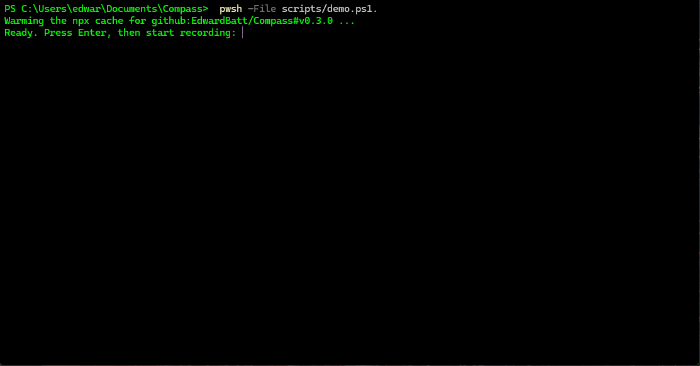

# Compass

**Shared project memory for AI coding agents, with a lint that keeps it honest.**



AI coding agents start every session knowing nothing about your project. They either read too much (slow, expensive, distracted) or too little (confident and wrong). Notes written to help them go stale silently, and each tool keeps its own copy of the rules.

Compass fixes that with three things:

1. **A tiered Markdown store in your repository** that sends each task to *one* short note and the source files that matter, instead of the whole codebase.
2. **Two routines**, *start* and *close*, that every agent follows: orient before work, and write back only what will still be true next quarter.
3. **A lint that treats memory rot as a build failure**: dead paths, notes that have grown into copies of the code, a plan that moved while the status file didn't, generated rules edited by hand.

One `compass.config.json` generates the instructions for **Claude Code, Cursor, Gemini, Antigravity and anything that reads `AGENTS.md`**, so every tool works from the same memory.

No database, no plugin, no dependencies: Node 18.17+ and git.

```
 task ──► MAP.md ──► one capsule ──► the source files ──► work ──► close ──► lint
            │            (≤ 60 lines)        (they win)               │
            └── STATE.md · traps.md index ◄────────── only what is durable
```

## Quick start

You need Node 18.17 or later and a git repository (run `git init` first in a new folder; the staleness checks and the hook read git). Then, in the repository:

```bash
npx --yes github:EdwardBatt/Compass#v0.3.1 init --tools claude,cursor,gemini,antigravity,agents --ci --hook
```

`init`:

- writes `compass.config.json`. It takes the owner from `git config user.name`, pins the Compass version it ran, and pre-fills `paths` with any plan, roadmap, decision-record folder or schema it finds under common names;
- creates the store in `docs/compass/`;
- generates every tool's instructions;
- with `--ci`, adds a GitHub Actions workflow; with `--hook`, adds a pre-commit hook;
- ends with numbered next steps.

Add `--project "Name"` and `--owner "Name"` to override what it guesses. List only the tools you use; `agents` covers any tool that reads `AGENTS.md`.

## See it filled in

[`examples/larder`](examples/larder) is a small, made-up app with a store as it looks after a few weeks of work. It lints clean, and the test suite keeps it that way. Read these to see what good looks like:

| File | Shows |
|---|---|
| [`MAP.md`](examples/larder/docs/compass/MAP.md) | rows worded as people speak, each routing to one capsule and the source |
| [`capsules/shopping-list.md`](examples/larder/docs/compass/capsules/shopping-list.md) | a capsule that points at source, says what deliberately does not work, and marks inference |
| [`STATE.md`](examples/larder/docs/compass/STATE.md) | what actually runs, including where the plan overstates it |
| [`traps.md`](examples/larder/docs/compass/traps.md) | entries worded as symptoms, each with its cost and the test that now catches it |
| [`sessions/2026-11-09.md`](examples/larder/docs/compass/sessions/2026-11-09.md) | the rare session note, with a trajectory whose `missed:` led to a new MAP row |
| [`compass.config.json`](examples/larder/compass.config.json) | a pinned config with a plan, decision records, a schema and a rules file |

## Adopting in an existing project

Do not try to document the codebase on day one. A store written up front is a guess about what agents will need, and most of it will never be read.

1. Run `init`, write the README paragraph, and check the `paths` it filled in.
2. Seed `traps.md` with the two or three failures everyone on the team already knows about: the ones a newcomer always hits.
3. If the plan overstates what is built, say so in `STATE.md`. That alone stops agents building on features that do not exist.
4. Then work normally. Each task the map cannot route is recorded as `missed:`, and close adds the row. After a few weeks, the map covers the areas people actually work in, and nothing else.

## Your first week

| When | What you do | What Compass does |
|---|---|---|
| **Day 0** | Run `init`. Replace the placeholder paragraph in `docs/compass/README.md` with three or four sentences about the project | The lint warns until the placeholder is gone |
| **Day 1** | Write a plan: a short list of milestones in any Markdown file. Set `paths.plan` (the lint suggests it if the file has a common name) and run `compass sync` | `/compass-start` with no task now proposes work from the plan. Until then, it explains that no plan is configured and what to do first |
| **First task** | `/compass-start add login` | The map is empty, so it reports *no row matched* and records that in its trajectory block. Compass is designed to fill itself from the tasks it could not route |
| **End of that session** | `/compass-close` | Adds a MAP row for login, moves login into STATE's *Working* section, ticks the plan. Adds a trap only if something cost real time and its cause was hidden |
| **First real decision** | — | Close drafts a decision record and stops for you to accept it. When the folder exists, the lint suggests setting `paths.adr`. After `sync`, every procedure checks decisions |
| **A domain gets complicated** | — | Close writes the first capsule: at most 60 lines, pointing at source rather than copying it. MAP routes to it with a one-sentence abstract the lint keeps identical |
| **Every commit** | — | The hook and CI fail on anything provably wrong. Warnings flag what is merely aging |

Most sessions write nothing. That is the intended outcome: a store that fills with notes nobody needed is the failure Compass exists to prevent.

## Daily use

The CLI sets Compass up. Day to day, two routines do the work, one at each end of a session.

| When | Claude Code | Other tools | What happens |
|---|---|---|---|
| Before work | `/compass-start <task>` | follow `docs/compass/protocol/start.md` | Reads the map, one capsule and the source it names, then reports what it loaded, the decisions and traps that apply, and anything waiting on a person. Ends with a trajectory block recording the context it was given |
| Not sure what to do next | `/compass-start` (no task) | same file, no task | Proposes a short, ranked list from STATE, the newest session note, git and the plan, then waits for you to pick. On an empty project, says what to do first |
| After work | `/compass-close` | follow `docs/compass/protocol/close.md` | Writes back only what is durable: a trap, a state change, a capsule edit, a missing map row, a new path in the config. Drafts decision records instead of putting decisions in notes. Runs the lint. **Most sessions write nothing** |
| Before every commit | `compass lint` (or your `lintCommand`) | same | Fails on anything provably wrong in the store |

Cursor, Gemini, Antigravity and `AGENTS.md` readers are pointed at the two protocol files by their generated rules, so you can ask them to "start Compass for <task>" or "close Compass".

## The store

| Tier | File | Read |
|---|---|---|
| 0 | `README.md` | every session: what the project is, and the rules of the store |
| 1 | `MAP.md` | every session: the words someone would say → one capsule → source files |
| 1 | `STATE.md` | when the task depends on what is built, broken, or waiting on a person |
| 1 | `traps.md` | before debugging: its index (worded as symptoms), then only the matching entries. Each entry is a `###` heading |
| 2 | `capsules/<one>.md` | only the one the map names; ≤ 60 lines; points at source |
| 3 | the source | always, last, and it wins |

`sessions/` holds the rare hand-over note; `archive/` holds what has been promoted or retired. `protocol/` is generated.

**What never goes in the store:** decisions (decision records), rules (your rules files), schemas and contracts (the code), plans and task lists (your plan). The store *points* at them. A copy is a second source of truth that will drift.

**Every note carries** `type`, `status`, `origin` (`human`, `human:<name>` to say which person, or `ai-derived`; an agent never rewrites a human's line) and `verified`, the date it was last checked against real code.

## What the lint checks

**Errors** — provably wrong right now; exit 1:

- front matter missing, or with an invalid `type`, `status`, `origin` or `verified`
- a front-matter key given twice, or two `MAP.md` rows for one task: what a merge leaves behind
- in team mode, a session note with no `author:`
- in a team store: a file in `traps/` that is not `type: trap` or whose name is not its `#` heading; a file in `state/` that is not `type: state`, has no valid `state:`, is `waiting` with no `waiting_on:`, or describes the same item as another; a file in `trajectories/` that is not `type: log`
- a dead link or a dead `#anchor`
- a backticked path in `MAP.md` or a capsule that does not exist, read from the project root
- a `sources:` entry that does not exist
- a capsule over its line cap, or an abstract that is missing, too long, or more than one sentence
- a `MAP.md` abstract that differs from its capsule's own
- a trap missing from the index, an index line with no entry, or a wrong anchor
- a `verified:` date in the future
- a generated file or block that differs from `compass sync` output
- a config path that does not exist

**Warnings** — judgement calls for a human:

- the configured plan or roadmap changed in git after `STATE.md` was verified
- a note's source changed in git after the note was verified (session notes excepted: they are snapshots)
- a note unverified for longer than `staleDays`
- a session note older than `promoteDays`: promote what is durable, then archive it
- `MAP.md`, `STATE.md`, the README, one MAP row or the traps index over its size cap
- a capsule that MAP never routes to
- a short path outside MAP and capsules
- a placeholder left by `init`
- with `--base`, a note whose source the branch changed while leaving the note alone
- in team mode, a session note named by date alone
- a plan, roadmap, decision folder or schema found on disk that the config does not name yet

Fenced code is never linted. Every path is resolved from the project root, so the lint gives the same answer from any subfolder.

## Commands

| Command | Does |
|---|---|
| `compass init` | Writes the config (owner from git, paths discovered) and the store if they are missing, then syncs. `--ci`, `--hook`, `--team`, `--tools`, `--project`, `--owner` |
| `compass sync` | Regenerates every tool's files from the config. `--check` only reports drift |
| `compass lint` | Rot detection. Exits 1 on any error. `--base <ref>` scopes warnings to what the branch changed |
| `compass report` | What the session notes say over time: unrouted tasks, misses, capsule use, in-flight work, stale notes by owner. `--json` |
| `compass doctor` | Shows the root, config, every generated file's status, every configured path, hints, hook, CI and the pinned version |
| `compass hook` | Installs a git pre-commit hook that runs the lint. In team mode, points `core.hooksPath` at the committed `.githooks/` |
| `compass version` | Prints the version |

All of them accept `--root <dir>`. Otherwise the root is the nearest folder holding `compass.config.json`, or else the git top level.

## Configuration

```jsonc
{
  "version": 1,
  "project": "My App",
  "owner": "Sam",
  "team": false,                   // true: several people at once (see "Working as a team")
  "approvers": [],                 // team mode: who accepts decision records; empty = owner
  "ownerCommits": true,            // close ends with "do not commit; Sam does"
  "store": "docs/compass",
  "tools": ["claude", "cursor", "gemini", "antigravity", "agents"],
  "pin": "v0.3.1",                  // the Compass version CI runs; '' = latest on main
  "lintCommand": "npm run compass", // what agents are told to run; unset = npx at the pinned version
  "ci": true,                       // also generate .github/workflows/compass.yml
  "paths": {
    "plan": "PLAN.md",              // '' = not set yet (the lint suggests candidates)
    "roadmap": false,               // false = this project has none (no suggestions)
    "adr": "docs/adr/",
    "schema": "prisma/schema.prisma",
    "rules": ["CONTRIBUTING.md"]
  },
  "authority": [],                  // Markdown lines, highest first; empty = derived from paths
  "state": { "inFlight": "In flight right now", "waiting": "Waiting on Sam" },
  "pointerNote": "",                // one extra project-specific line in every tool's pointer
  "targets": { "gemini": ".gemini/GEMINI.md" },  // where each tool's file lives
  "caps": { "capsuleLines": 60, "mapRowChars": 1200, "fileChars": { "MAP.md": 12000 } },
  "ignorePaths": []                 // backticked path prefixes the lint must not resolve
}
```

Compass acts only on what the config says. Paths it discovers are suggestions you confirm, never behaviour. Defaults are in [`src/config.mjs`](src/config.mjs).

### What is generated, and what is yours

| Generated by `compass sync` — never edit | Yours |
|---|---|
| `docs/compass/protocol/start.md`, `close.md` | `compass.config.json` |
| `.claude/commands/compass-start.md`, `compass-close.md` | every note in `docs/compass/` |
| `.cursor/rules/compass.mdc` | everything outside the `compass:begin` / `compass:end` markers |
| the block between `compass:begin` and `compass:end` in the store README, `CLAUDE.md`, `AGENTS.md`, `GEMINI.md` and the Antigravity rules | |
| `.github/workflows/compass.yml` (when `ci` is on) | |

To change a procedure, change the config, or change Compass and run `sync` in each project. The lint fails on hand edits, so the copies for different tools can never drift apart.

## Working as a team

By default Compass assumes one person at a time: the procedures speak to the owner, and `STATE.md` carries what is in flight. On a shared repository that breaks. Every branch edits the same lines of `STATE.md` and `traps.md`, two people on the same day write the same session note, and "Waiting on Sam" stops meaning anything. Turn on team mode:

```bash
npx --yes github:EdwardBatt/Compass#v0.3.1 init --team ...   # new project
# existing project: see "Switching an existing store" below
```

**The rule team mode is built on: no two branches edit the same lines.** Anything several people add to is a folder with one file per entry, so parallel branches add different files, and every forge merges that cleanly. Team mode does not use merge drivers such as `merge=union`: GitHub, GitLab and Bitbucket ignore them when they merge a pull request ([GitHub](https://github.com/orgs/community/discussions/9288), [GitLab](https://gitlab.com/gitlab-org/gitlab-foss/-/issues/17325)). What still conflicts is a real disagreement, such as one item changed two different ways on two branches, and a person should settle it.

| | Solo | Team |
|---|---|---|
| Who the procedures speak to | the owner | whoever is running the agent, read from `git config user.name` at run time |
| Who accepts a decision record | the owner | `approvers`, in review |
| What is built | `STATE.md`, one file | `state/<item>.md`, one file per item, with `state:` (`working`, `partial`, `absent`, `broken` or `waiting`, plus `waiting_on:`). Describes the main branch. Start reads it with one search for the `state:` lines, about 15–20 tokens per item, then opens only the items it needs |
| Traps | entries in `traps.md`, with an index | `traps/<symptom>.md`, one file per trap, named as its symptom. The folder listing is the index, so there is no index file to edit |
| Trajectories | in the rare session note | **every** close appends one line to its author's own log, `trajectories/<who>.md`, so `compass report` sees the whole team's misses. Close appends without reading the file, and nothing but the report reads it |
| In-flight work | `STATE.md` | the author's own session note, `sessions/YYYY-MM-DD-<who>-<topic>.md`, with `author:` and `branch:`. Nobody edits a teammate's note |
| Start with no task | proposes from the newest note | proposes the operator's own work first, then lists what teammates have in flight, so nobody takes work someone already has |
| `MAP.md` | one file | still one file, because it is read whole to route a task. Rows are kept in alphabetical order and a new row goes in its place, and adding a row does not bump `verified:`, so branches adding different rows usually touch different lines. Two rows added in the same alphabetical gap still conflict; keep both |
| The pre-commit hook | in `.git/hooks`, one copy per clone | committed in `.githooks/`, generated and drift-checked like every other file. Each clone runs `compass hook` once to point `core.hooksPath` at it. It refuses to take over another hook manager's `hooksPath`, or to switch while `.git/hooks` holds hooks that would stop running |
| CI on a pull request | the full lint | `lint --base origin/<target>` (see below) |

Two more tools work in any mode, but matter most on a team:

- **`compass lint --base <ref>`** compares the branch with where it left `<ref>`. Errors are still reported everywhere, because a change anywhere can break a note nobody touched (delete a file and the capsule pointing at it is now wrong). Warnings are limited to the files the branch changed, so a pull request isn't buried under the whole project's ageing notes. It adds one check: **a note whose source the branch changed, while leaving the note alone**. A capsule describes the files it backticks and its `sources:`; STATE and traps describe their `sources:`.
- **`compass report`** reads every session note, live and archived, and gathers what one person's notes can't show: the tasks the map could not route, what tasks turned out to need (`missed:`, counted), which capsules are actually loaded and which never are, what each person has in flight (flagging notes whose branch is merged or gone), and stale notes by owner. `--json` for scripts.

A note can name who answers for it with `owners: [alice, bob]` in its front matter. Every error and warning about that note then ends with `(owners: alice, bob)`, and the report groups stale notes by owner.

**Personal notes do not go in the store.** Everyone's agents read it. One person's scratch notes and preferences belong in their tool's local memory (in Claude Code, `CLAUDE.local.md` or `/memory`).

Nothing user-specific goes in the committed config. The operator is read at run time, so every teammate's generated files are identical and the drift check still holds.

### Switching an existing store

1. Set `"team": true` and `approvers` in `compass.config.json`, then run `compass init` again. It creates the `state/`, `traps/` and `trajectories/` folders, regenerates every procedure, and leaves every existing note alone. Commit `.gitattributes` and `.githooks/` with it.
2. Move each line of `STATE.md` into its own `state/<item>.md`, move *In flight* lines into the right person's session note, then delete `STATE.md`.
3. Existing traps can stay in `traps.md`, which still lints; new ones go in `traps/`.
4. Rename live session notes to `YYYY-MM-DD-<who>-<topic>.md` and add `author:` (the lint lists them), or archive them.
5. Each teammate runs `compass hook` once.

## CI

`compass sync` with `"ci": true` writes `.github/workflows/compass.yml`, which runs the lint on every push and pull request with full git history, so the staleness checks work. It needs no secrets.

The workflow checks out the version in `pin`, so CI runs the same Compass as your machine. With `pin` set to `''`, it runs the latest commit on `main`.

## Upgrading

1. Read the [CHANGELOG](CHANGELOG.md) for the new version.
2. Set `"pin"` in `compass.config.json` to the new tag, and update the tag in your own `lintCommand` or npm script if it names one.
3. Run `npx --yes github:EdwardBatt/Compass#<new tag> sync`. It rewrites every generated file to match.
4. Run the lint, and commit the config and the regenerated files together.

Until step 3, the lint reports the generated files as drift. That is intended: it means a procedure changed. `compass sync` and `compass doctor` say when the copy you are running is not the pinned version.

## Troubleshooting

| Symptom | Cause and fix |
|---|---|
| `npx github:EdwardBatt/Compass#vX.Y.Z …` prints nothing and exits 1 | The tag does not exist. Check the tag list on GitHub, or `git ls-remote --tags https://github.com/EdwardBatt/Compass` |
| An old version runs after an upgrade | npx cached it. Delete the `_npx` folder in your npm cache (`npm config get cache` shows where), then rerun |
| Every generated file is drift after an upgrade | Expected. Run `sync` at the new version (see *Upgrading*) |
| The lint fails on a file you never edited | A teammate synced with a different version. Run `compass doctor` to compare versions, then sync at the pinned one |
| The pre-commit hook does not run on Windows | Git for Windows runs hooks through its own `sh`, so commit from Git Bash, GitHub Desktop or VS Code. A hook installed from WSL needs WSL's `node` |
| A trap is "not in the index", or the index lists one with "no entry" | The entry must be a `###` heading, and the index line must copy it exactly. The error gives the anchor it expects |

## Design principles

- **The source wins.** A note is orientation, dated and assumed stale until checked. When a note contradicts the code, the note is fixed in the same session.
- **Point, don't copy.** Capsules are capped at 60 lines, and backticked paths must resolve, so a note stays a pointer rather than becoming a second copy of the code.
- **Errors are facts; warnings are judgement.** The lint fails only on things that are provably wrong right now.
- **Most sessions write nothing.** The bar for a trap is that it cost real time *and* its cause was hidden.
- **Hindsight is data.** The trajectory block's `missed:` field records what the map failed to point at — the only evidence for *why did the agent miss X*.
- **Project-agnostic.** Nothing in Compass knows your stack, your plan's name or your folder layout; the config does.

## Developing

```bash
npm test     # node:test, no dependencies; CI runs it on Linux, Windows and macOS, Node 18–22
pwsh -File scripts/demo.ps1   # replays the README demo in a temp folder, for re-recording docs/CompassDemo.gif
```

See [CHANGELOG.md](CHANGELOG.md).

## Licence

[Mozilla Public License 2.0](LICENSE). You can use Compass in any project, commercial or closed-source, and your own files stay yours. If you distribute a modified version of Compass's own files, those changes must be shared under the MPL too.

**Exception for generated files.** Files that `compass init` and `compass sync` generate in your project, and the notes you write in your Compass store, are yours to use, change and distribute under any terms you choose. The MPL does not apply to them. It applies only to Compass itself.
